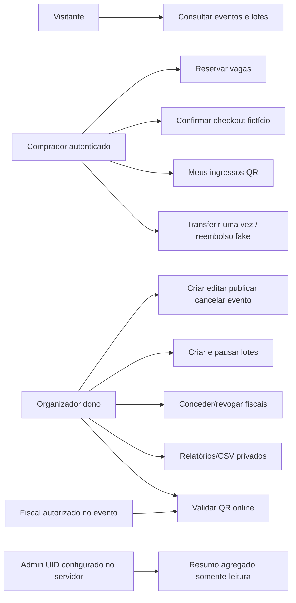
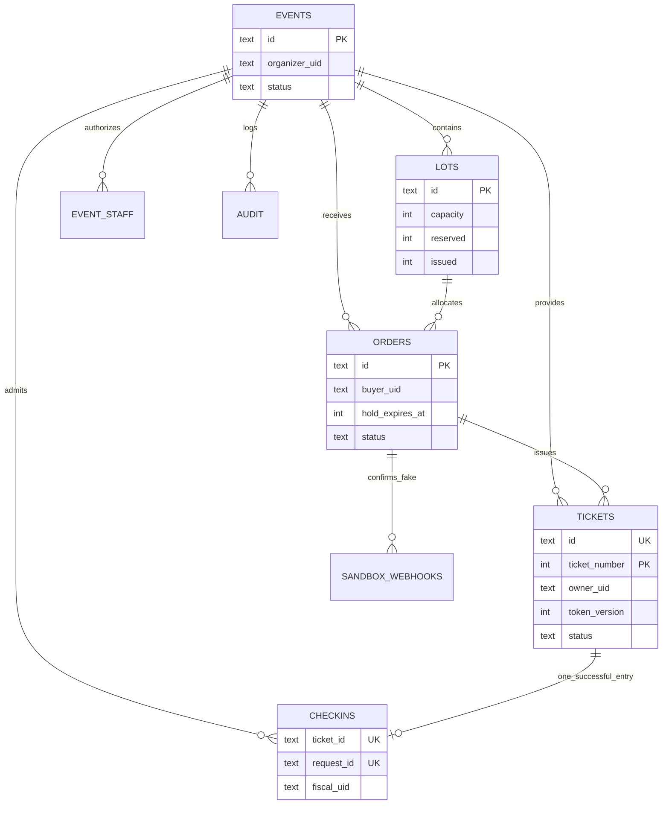
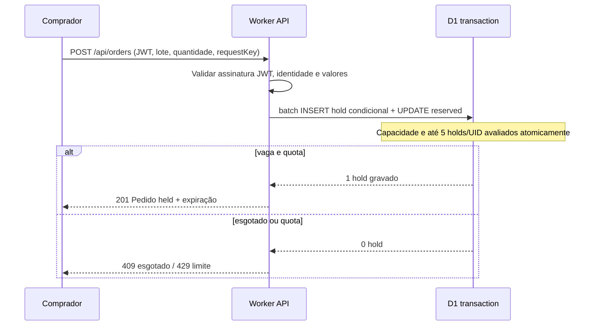
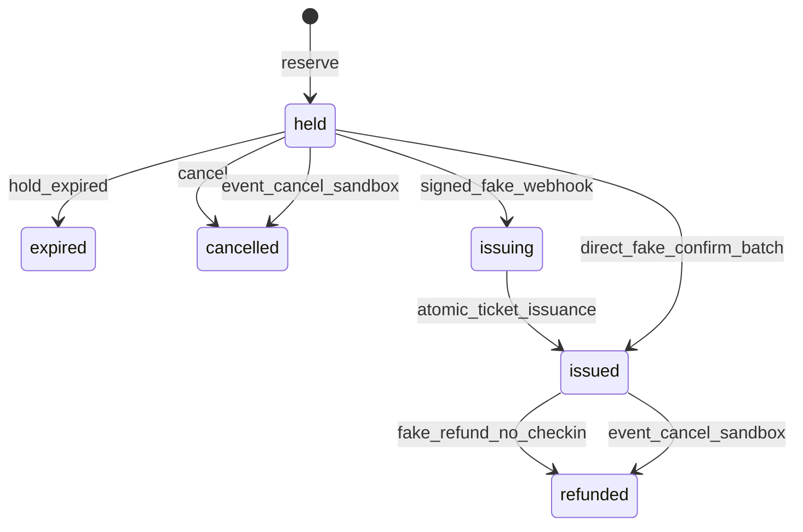
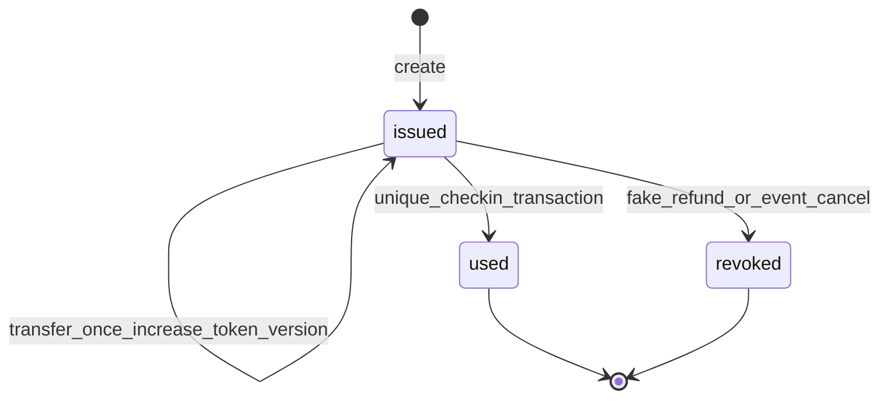
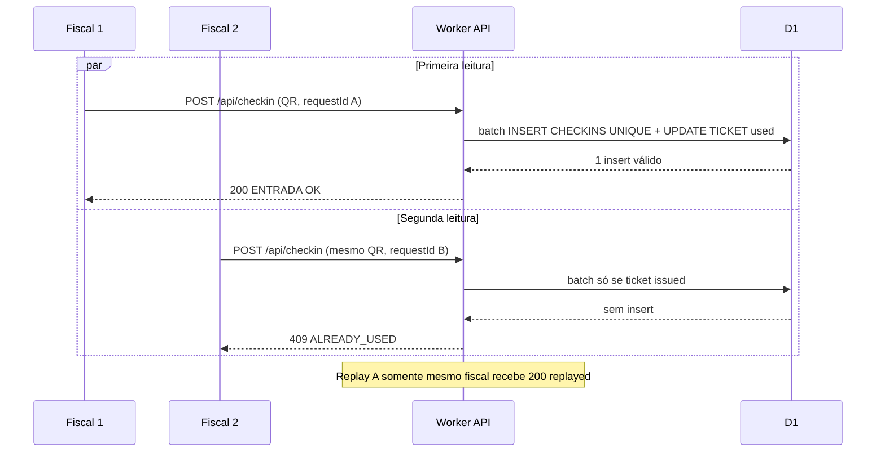
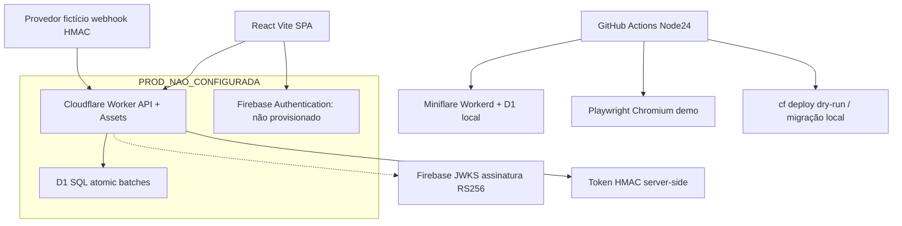

# RFBTicket — D001–D007 conforme código implementado (S009, não produção)

**Escopo:** documentação técnica dos componentes que EXISTEM na branch Draft em c0f85cd7f2d8be13c4216e7e3d90d1bf3e6ded72. Não substituir a versão conceitual `docs/DIAGRAMAS.md`; este documento registra o funcionamento efetivamente programado. Ambiente remoto não implantado.

## D001 — Papéis e autorizações reais (mapa de casos)

## D002 — Entidades persistidas no schema D1 (simplificado)

## D003 — Fluxo de reserva em concorrência

## D004 — Estados implementados do pedido

## D005 — Estados e rotação do ingresso

## D006 — Porta de entrada dupla, idempotência e recusa

## D007 — Componentes e ambientes

**Segurança:** segredo QR e webhook somente Worker bindings; autenticação real precisa Firebase project; checkout e reembolso são fictícios, nenhum dinheiro. D1 local Miniflare passou concorrência; D1 remoto e dispositivos reais NÃO testados. Diagramas descrevem estrutura simplificada, não os 58 layouts visuais.
