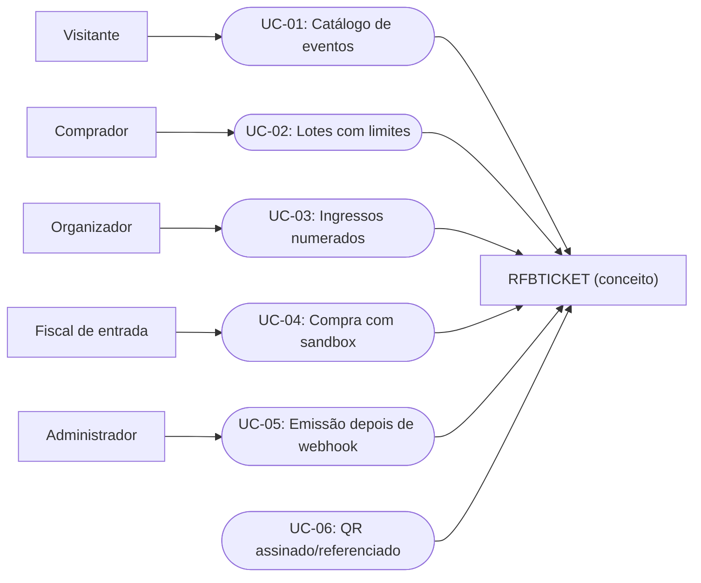
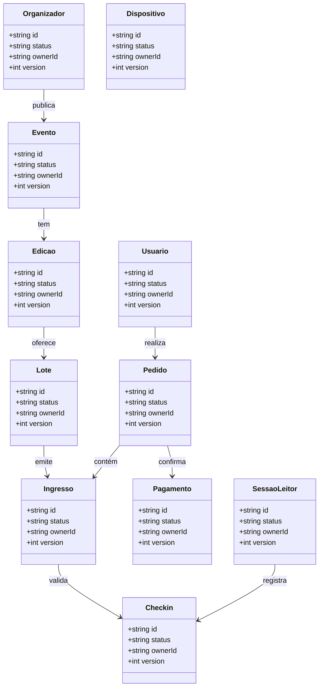
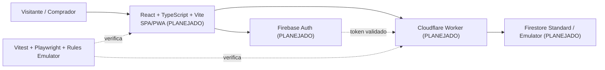
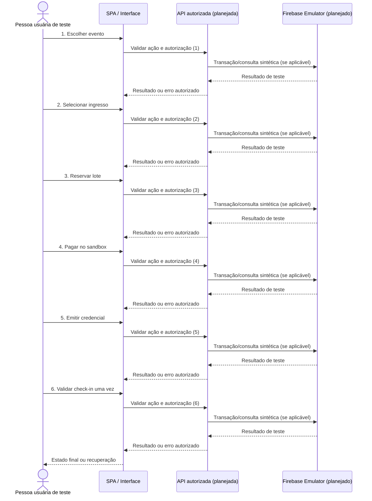
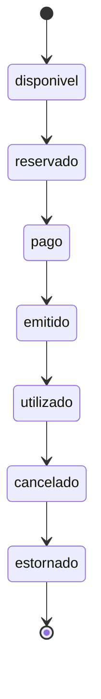
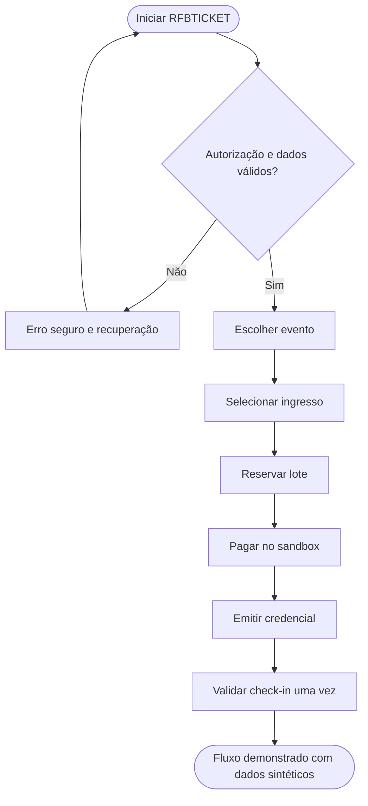

# RFBTICKET — Diagramas do Starter Pack (Mermaid editável)

> **ORIGEM:** entidades/estados/jornada retirados de `ESPECIFICACAO-RFB.txt`; relações propostas transcritas de `repos-individuais/11-rfbticket/DATA/RELACOES-DE-DOMINIO.md` do ZIP original enviado. Toda associação é **proposta**, sem cardinalidade homologada. **Nenhum desses gráficos comprova aplicação ou banco existente.** Mermaid é notação prática, não substitui artefato UML formal.

## D-001 — Atores e casos de uso (mapeamento inicial)

O mapeamento é exploratório. Atribuição ator→caso tem de ser validada com a matriz de permissões; a ordem dos papéis na fonte não determina autorização automática.

## D-002 — Modelo conceitual de classes

**Relações propostas da fonte (a validar):**
- `Organizador` → `Evento` — publica
- `Evento` → `Edicao` — tem
- `Edicao` → `Lote` — oferece
- `Lote` → `Ingresso` — emite
- `Usuario` → `Pedido` — realiza
- `Pedido` → `Ingresso` — contém
- `Pedido` → `Pagamento` — confirma
- `Ingresso` → `Checkin` — valida
- `SessaoLeitor` → `Checkin` — registra

Não são FK/coleções já criadas. `ownerId`/`version` são campos candidatos genéricos definidos no caderno; modelagem real terá índices, escopo de tenant, constraints e testes de concorrência.

## D-003 — Entidade-relacionamento sem cardinalidades inventadas

```mermaid
erDiagram
  Usuario {
    string id PK
    string status
    string ownerId
    datetime createdAt
  }
  Organizador {
    string id PK
    string status
    string ownerId
    datetime createdAt
  }
  Evento {
    string id PK
    string status
    string ownerId
    datetime createdAt
  }
  Edicao {
    string id PK
    string status
    string ownerId
    datetime createdAt
  }
  Lote {
    string id PK
    string status
    string ownerId
    datetime createdAt
  }
  Ingresso {
    string id PK
    string status
    string ownerId
    datetime createdAt
  }
  Pedido {
    string id PK
    string status
    string ownerId
    datetime createdAt
  }
  Pagamento {
    string id PK
    string status
    string ownerId
    datetime createdAt
  }
  Checkin {
    string id PK
    string status
    string ownerId
    datetime createdAt
  }
  SessaoLeitor {
    string id PK
    string status
    string ownerId
    datetime createdAt
  }
  Dispositivo {
    string id PK
    string status
    string ownerId
    datetime createdAt
  }
```

Os nomes provêm do planejamento; as relações estão em D-002 mas **deliberadamente sem 1:1, 1:N ou N:M**, pois o ZIP proíbe inferir cardinalidade automaticamente. Definir cardinalidades, deleção, transações e tenant invariants antes do Firestore.

## D-004 — Arquitetura de contêineres candidata (visão C4 aproximada)

Antes de deploy confirmar configuração atual de Cloudflare, Firebase Spark, SDK no runtime, limites/custos, upload, autenticação e isolamento. A arquitetura acima NÃO está operacional.

## D-005 — Sequência do fluxo principal (planejado)

Pseudointeração, não endpoints existentes. Criar contratos reais em G1/G2, incluir falha de rede, permissão negada, retry, duplicação e concorrência.

## D-006 — Máquina de estados do domínio (fonte)

Transições não autorizadas devem ser recusadas; definir precondição, agente, logs, efeitos transacionais e reversões para cada aresta.

## D-007 — Atividade e exceção principal

O diagrama representa o cenário mínimo. Cenários alternativos não estão todos detalhados; desenvolver quando o primeiro fluxo estiver em código.

## Catálogo de diagramas: aplicabilidade de 14 UML + 4 C4 + ERD

| Tipo considerado | Estado |
|---|---|
| UML: casos de uso | RASCUNHO — atores e casos via fluxograma Mermaid, revisar UML formal |
| UML: classes | RASCUNHO — entidades e relações propostas do ZIP |
| UML: objetos | AVALIAR necessidade após contratos de dados |
| UML: pacotes | AVALIAR quando os módulos forem implementados |
| UML: componentes | AVALIAR depois da definição da API |
| UML: estrutura composta | AVALIAR apenas se houver interfaces internas complexas |
| UML: implantação | AVALIAR após decisão Cloudflare/Firebase e staging |
| UML: perfis | AVALIAR necessidade de estereótipos específicos |
| UML: atividades | RASCUNHO — jornada com autorização/erro |
| UML: estados | RASCUNHO — sequência de estados original |
| UML: sequência | RASCUNHO — interações previstas, backend NÃO implementado |
| UML: comunicação | AVALIAR após contrato de comunicação |
| UML: visão geral de interação | AVALIAR para fluxos concorrentes complexos |
| UML: timing | AVALIAR apenas se tempo/liveness for requisito |
| C4: contexto | RASCUNHO — atores externos ainda devem ser confirmados |
| C4: contêineres | RASCUNHO — stack original candidata, não deployed |
| C4: componentes | AVALIAR após implementação de API/UI |
| C4: código | AVALIAR após G2, sem diagrama vazio artificial |
| ERD | RASCUNHO — entidades sem inventar cardinalidades |

**Critério de manutenção:** requisitos `F-IDs` e telas `T001..T058` devem indicar o D-ID pertinente; nenhuma classe/relacionamento vai para produção sem teste Rules/contratos e revisão de modelagem. Diagramas de objetos, perfil, timing, composite structure etc. NÃO são gerados apenas para preencher catálogo quando não são adequados.
